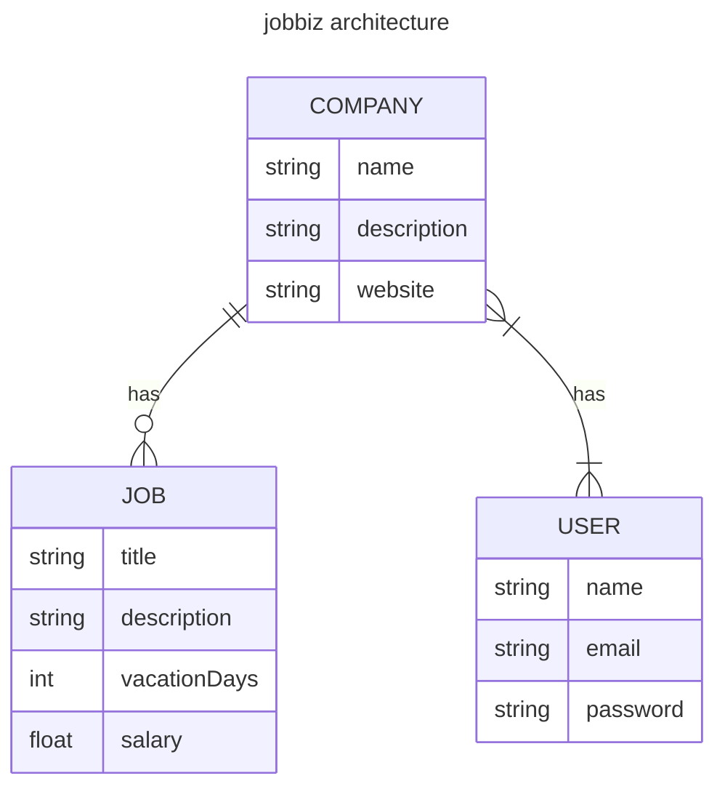

# tm-cs-jobbiz

Platform managing job offers written with php/laravel. It currently exposes a REST API for managing users and companies (job offers are planned), built with Laravel 13 and secured with Laravel Sanctum token authentication.

## Architecture


## Requirements

- PHP >= 8.3
- [Composer](https://getcomposer.org/) 2.x
- [Node.js](https://nodejs.org/) and npm — only needed to build the frontend assets
- SQLite — default database; MySQL/PostgreSQL can be configured via `.env`

## Installation

> The current release lives on the `dev` branch.

```bash
git clone -b dev git@github.com:echooh/tm-cs-jobbiz.git
cd tm-cs-jobbiz
composer install
cp .env.example .env
php artisan key:generate
touch database/database.sqlite
php artisan migrate
php artisan db:seed   # optional — creates a test user (test@example.com / testpassword)
npm install && npm run build   # optional — only needed for the frontend assets
php artisan serve
```

The API is now available at `http://localhost:8000`.

> **Tip:** `composer run setup` performs the first-time setup in one command: install dependencies, create `.env`, generate the app key, run migrations, and build the frontend assets.

## Routing table

| Method | URI | Action | Auth | Notes |
|---|---|---|---|---|
| GET | `/` | Closure | – | Web welcome page |
| POST | `/api/register` | `AuthController@register` | – | Creates a user; returns user + token (201) |
| POST | `/api/login` | `AuthController@login` | – | Returns a token |
| GET | `/api/user` | Closure | Sanctum | Returns the current authenticated user |
| GET | `/api/users` | `UserController@index` | Sanctum | Paginated (15 per page) |
| POST | `/api/users` | `UserController@store` | Sanctum | Validates `name`, unique `email`, confirmed `password` (min. 8) |
| GET | `/api/users/{user}` | `UserController@show` | Sanctum | |
| PUT/PATCH | `/api/users/{user}` | `UserController@update` | Sanctum | Own profile only |
| DELETE | `/api/users/{user}` | `UserController@destroy` | Sanctum | Own profile only; 204 No Content |
| GET | `/api/companies` | `CompanyController@index` | Sanctum | Paginated (15 per page) |
| POST | `/api/companies` | `CompanyController@store` | Sanctum | 201; the creator is automatically attached |
| GET | `/api/companies/{company}` | `CompanyController@show` | Sanctum | |
| PUT/PATCH | `/api/companies/{company}` | `CompanyController@update` | Sanctum | ⚠️ Stub — not implemented yet |
| DELETE | `/api/companies/{company}` | `CompanyController@destroy` | Sanctum | ⚠️ Stub — not implemented yet |

All `/api/*` routes except `register` and `login` require a Sanctum token.

## Authentication

The API is secured with [Laravel Sanctum](https://laravel.com/docs/sanctum) bearer tokens. Register or log in to obtain a token, then send it with every authenticated request in the `Authorization` header.

**Register a user** — returns the new user and a token:

```bash
curl -X POST http://localhost:8000/api/register \
  -H "Content-Type: application/json" \
  -d '{"name": "Jane Doe", "email": "jane@example.com", "password": "secret123", "password_confirmation": "secret123"}'
```

**Log in** — returns a token:

```bash
curl -X POST http://localhost:8000/api/login \
  -H "Content-Type: application/json" \
  -d '{"email": "jane@example.com", "password": "secret123"}'
```

**Authenticated request**:

```bash
curl http://localhost:8000/api/user \
  -H "Authorization: Bearer <token>"
```

If you seeded the database, you can log in with the test user: `test@example.com` / `testpassword`.

## Project structure

```
app/
├── Http/
│   ├── Controllers/    # Auth, User, and Company controllers
│   ├── Requests/       # Form request validation (Store*/Update* classes)
│   └── Resources/      # API resources (UserResource, CompanyResource)
├── Models/             # User and Company (many-to-many relationship)
└── Policies/           # UserPolicy and CompanyPolicy (authorization)
database/
├── migrations/         # users, companies, company_user pivot, Sanctum tokens
└── seeders/            # DatabaseSeeder (creates the test user)
routes/
└── api.php             # API route definitions
```
